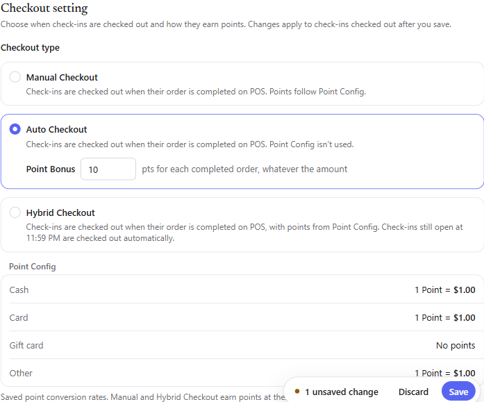
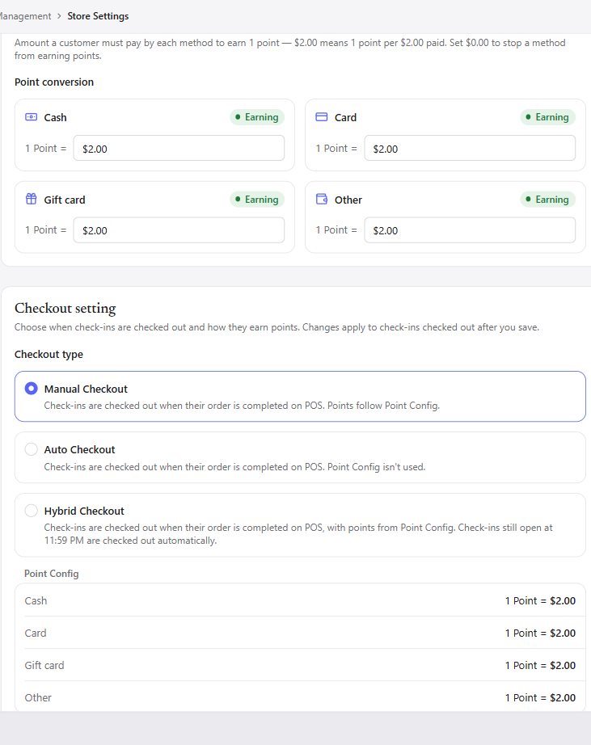
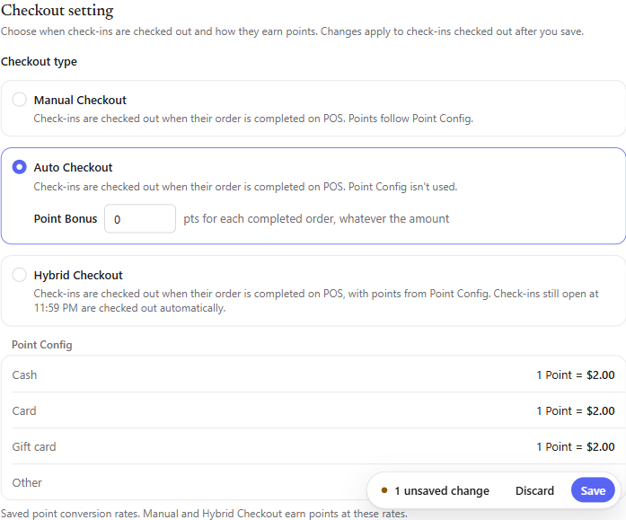
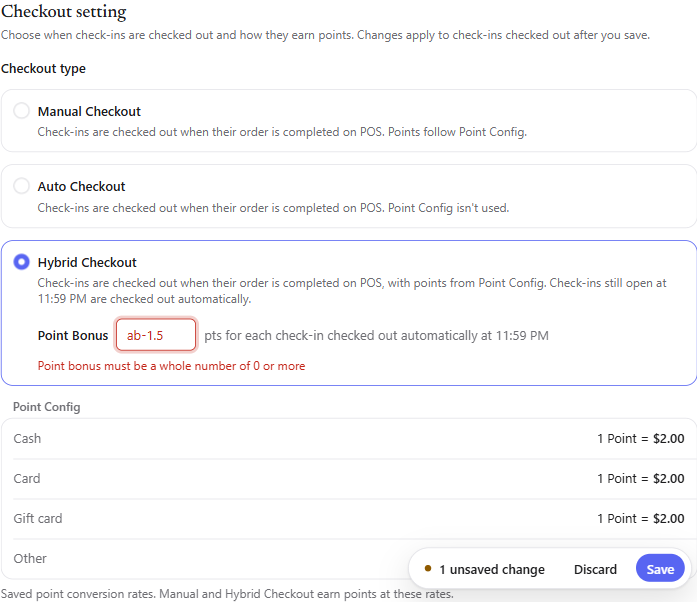

# Báo cáo verify — Checkout Type Setting + Point Bonus (VP-4590 / VP-4974)

- Môi trường: stage/DEV (https://v2.dev-fastboypay.com) · Tab **Store Settings > Payment & transactions > Checkout setting**
- Stores test: **#14** "Volt POS tiem test 14 v1" (môi trường repro gốc của VP-4974) và **#100004** "Test 100004" (validation field)
- Ngày: 2026-10-23 · Người test: Claude (explore-bug-hunt) · User: khanh_do@fastboy.net
- Task: [VP-4590 Checkout Type Setting](https://linear.app/fastboy/issue/VP-4590) (Ready to Review) · Bug subtask: [VP-4974](https://linear.app/fastboy/issue/VP-4974) (Ready to Review, có PR fix [#870](https://github.com/FastboyMarketing/fastboy-portal/pull/870))
- **Kết quả: VP-4590 PASS (7/7 AC) · VP-4974 ĐÃ FIX (PASS)** · 0 bug · 1 ghi nhận nhỏ (trùng id `cash`, liên quan VP-4093).

## 1. VP-4974 — "Point Bonus giữ giá trị nháp sau khi Save, không sync với data đã lưu"

### Bản chất bug (theo mô tả task)

Khi nhập Point Bonus ở thẻ Auto/Hybrid (giá trị nháp, hợp lệ hay không), rồi chuyển về **Manual** và **Save** → form **không reset** theo data đã lưu: ô Point Bonus vẫn giữ giá trị nháp (vd `abc` hoặc `5`) kèm lỗi + "1 unsaved change", dù DB đã đúng. Chỉ hết khi reload/Discard. Kèm theo: toast hiện "Point settings saved" thay vì "Checkout setting saved.".

### Kết quả re-test đúng repro (store #14, baseline Hybrid + point_bonus 10)

| Bước | Thao tác                                                       | Kết quả                                                                  | Đạt          |
| ---- | -------------------------------------------------------------- | ------------------------------------------------------------------------ | ------------ |
| 1–2  | Chọn **Auto** → nhập Point Bonus = `abc`                       | field báo lỗi "Point bonus must be a whole number of 0 or more"          | —            |
| 3    | Chọn **Manual** → **Save**                                     | Lưu thành công, save bar biến mất, **toast = "Checkout setting saved."** | ✅           |
| 4    | Chọn lại **Auto**                                              | Point Bonus hiện **`10`** (giá trị DB), **không còn `abc`**, không lỗi   | ✅ **FIXED** |
| —    | Biến thể hợp lệ: Auto nhập `5` → Manual → Save → chọn lại Auto | hiện **`10`** (không giữ `5`)                                            | ✅ **FIXED** |

→ Draft Point Bonus **được reset đúng theo DB** sau khi Save; toast đúng là **"Checkout setting saved."**. Cả 2 triệu chứng của bug (giữ giá trị nháp + sai toast) đều **không còn tái hiện**. Bug đã fix.

Bằng chứng:  — sau khi nhập nháp rồi Save-Manual, chọn lại Auto thấy Point Bonus = 10, không lỗi.

## 2. VP-4590 — Acceptance Criteria (7/7 PASS)

| #   | Acceptance Criteria                                                                          | Kết quả                                     |
| --- | -------------------------------------------------------------------------------------------- | ------------------------------------------- |
| 1   | Checkout Setting nằm cạnh Point Config; tiệm chưa lưu → Manual + Point Bonus 0               | ✅ (vị trí đúng; mặc định Manual)           |
| 2   | Point Bonus chỉ hiện ở thẻ Auto/Hybrid đang chọn; Auto↔Hybrid giữ giá trị đang nhập          | ✅ (giá trị dùng chung, carry khi đổi thẻ)  |
| 3   | Point Bonus rỗng/âm/số lẻ → không lưu được, báo lỗi tại field                                | ✅ (xem bảng validation §3)                 |
| 4   | Save thành công "Checkout setting saved."; reload thấy đúng type + bonus                     | ✅ (toast đúng; reload giữ Hybrid+10)       |
| 5   | Chọn Manual rồi Save → `point_bonus` cũ vẫn giữ                                              | ✅ (point_bonus giữ 10 sau khi Save Manual) |
| 6   | Lưu Checkout không mất Point Config, và lưu Point Config không mất Checkout Type/Point Bonus | ✅ **2 chiều** (xem §4)                     |
| 7   | Khung Point Config bên dưới hiện đúng tỉ lệ đang lưu                                         | ✅ ($1.00/$1.00/No points/$1.00 khớp)       |

### Mô tả 3 thẻ (khớp spec)

- **Manual Checkout**: không có ô Point Bonus; "Points follow Point Config".
- **Auto Checkout**: "Point Bonus [ ] pts for each completed order, whatever the amount"; "Point Config isn't used".
- **Hybrid Checkout**: "Point Bonus [ ] pts for each check-in checked out automatically at 11:59 PM"; vẫn hiện Point Config (dùng cho order hoàn tất).

## 3. Validation field Point Bonus (store #100004 & #14)

| Input     | Field     | `aria-invalid` | Message                                           | Save     |
| --------- | --------- | -------------- | ------------------------------------------------- | -------- |
| `abc`     | giữ `abc` | true           | "Point bonus must be a whole number of 0 or more" | **chặn** |
| `-5`      | giữ `-5`  | true           | nt                                                | **chặn** |
| `2.5`     | giữ `2.5` | true           | nt                                                | **chặn** |
| rỗng      | rỗng      | true           | "Point bonus is required"                         | **chặn** |
| `5` / `0` | `5` / `0` | false          | —                                                 | lưu được |

Đã xác nhận: bấm Save khi field invalid → **không có request ghi** (chỉ GET). Validation nhất quán ở cả Auto và Hybrid.

## 4. Non-clobber giữa Checkout setting và Point Config (AC#6 — rủi ro schema trong Notes)

- **Lưu Checkout setting** (đổi type + Save) → Point Config giữ nguyên ($1.00…). ✅
- **Lưu Point Config** (sửa Cash $1.00→$1.50 + Save, toast "Point settings saved") → reload thấy **Checkout Type vẫn Hybrid, Point Bonus vẫn 10**. ✅
- Hai form cùng flag `merchant_point_payment_config` nhưng **không ghi đè key của nhau**. (Đã revert Cash về $1.00.)

## 5. Lưu & toast

- Checkout type lưu qua `PUT /sys_settings/{id}` → 200, persist sau reload.
- Toast phân biệt đúng: sửa Checkout → **"Checkout setting saved."**; sửa Point Config → **"Point settings saved"**.

## 6. Ghi nhận nhỏ (không chặn)

- **Trùng `id="cash"`** giữa switch payment method "Cash" và input Point conversion "Cash" → liên quan [VP-4093](https://linear.app/fastboy/issue/VP-4093) (đã biết). Không ảnh hưởng Checkout setting.
- **Point Bonus không có cap trên** (store #100004 nhận `999999`). Nghiệp vụ nên cân nhắc giới hạn, nhưng ngoài scope AC VP-4590.
- Console `401 GET sys.../sessions/current`: call auth nền, không liên quan.

## 7. Dữ liệu test & revert

- Store #14 đã **revert về nguyên trạng**: Hybrid Checkout + Point Bonus 10 + Point Config Cash/Card/Other $1.00, Gift card No points.
- Store #100004: chỉ thử nhập (không Save) hoặc Save rồi revert → về Manual + Point conversion $2.00.

## 8. Kết luận & hành động Linear

- **VP-4974: ĐÃ FIX** và **VP-4590: PASS toàn bộ AC** trên DEV → đã comment "I have verified that the task passed on dev thank you @ngan_huynh cc @tienpd @loan_dang" lên cả VP-4974 và VP-4590 (2026-10-23).
- Không tạo subtask bug (không có lỗi chặn).

## Bằng chứng khác

- Checkout setting + Point conversion (store #100004): 
- Auto Checkout hiện field Point Bonus: 
- Validation Point Bonus khi nhập sai: 
- VP-4974 draft reset đúng DB sau Save: 
